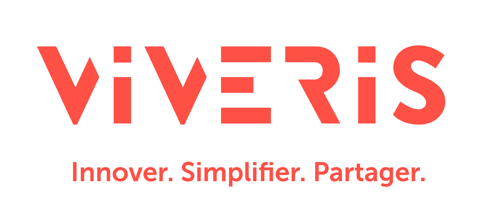
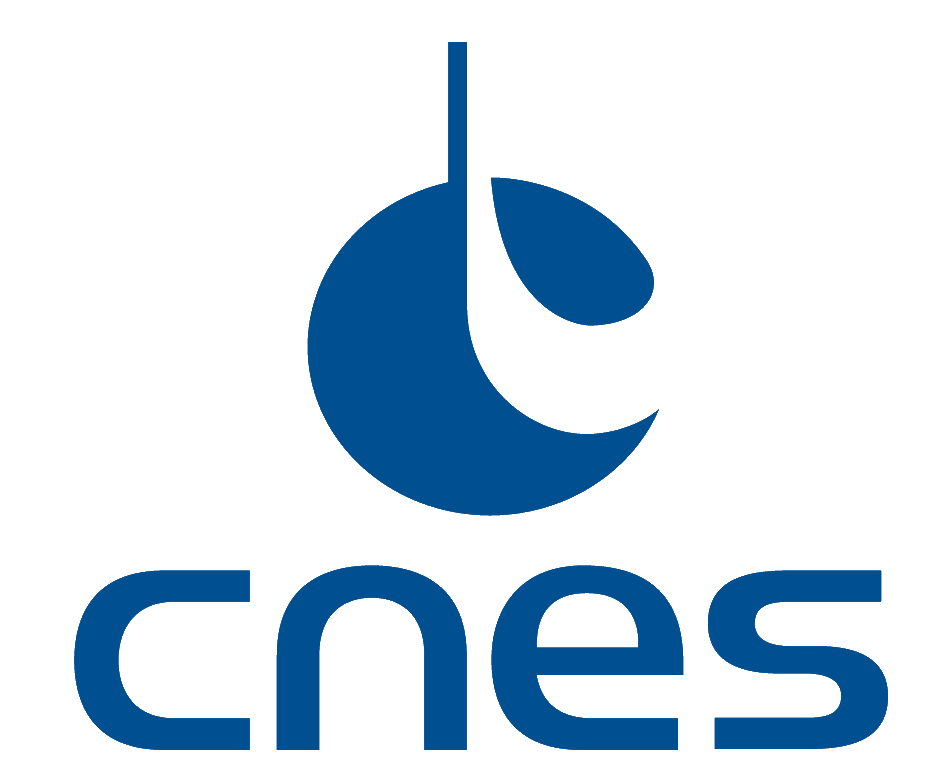

# LoCod: an open-source hardware/software co-design framework

LoCod is a fully open-source hardware/software co-design tool, developed by CNES and Viveris in the frame of a CNES [R&T](https://rd-cnes.wiin.io/fr/directories/appels-a-idees-ouverts/) study.

**LoCod source code and examples** available on **[Viveris repository: https://github.com/viveris/LoCod/](https://github.com/viveris/LoCod/)**

**Conference paper** introducing LoCod available **[here](https://indico.cern.ch/event/1381060/contributions/5923282/)** or **[here](https://www.spiedigitallibrary.org/conference-proceedings-of-spie/supplementalcontent/10.1117/12.3061330/38m.pdf)**.

